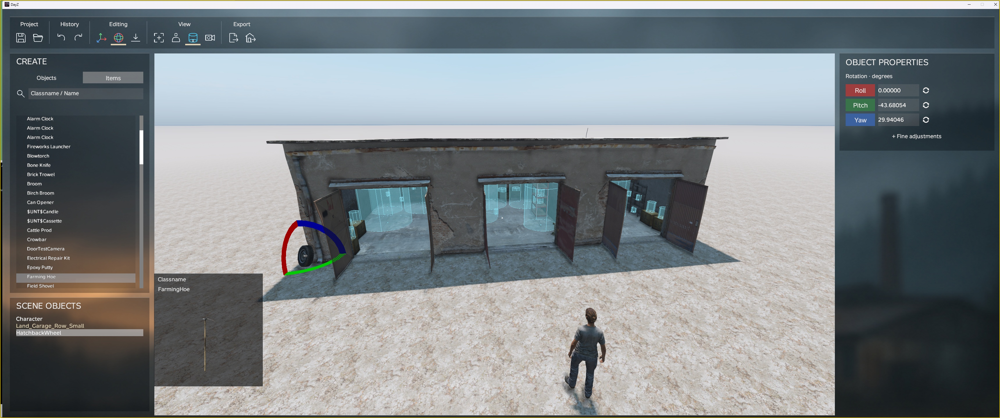
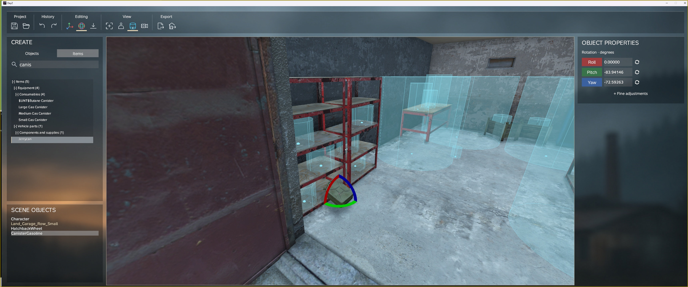

# Proxy Placement Tool

[Steam Workshop](https://steamcommunity.com/sharedfiles/filedetails/?id=3839146464) · [English](README.md) · [Сборка](docs/BUILD.md) · [Проверки](docs/VALIDATION.md)

Автор: **Medoedovich** · **1.0.0** · **только DayZDiag, офлайн**

Инструмент для подбора позиции и углов предметов относительно зданий и остовов с экспортом CE `dispatch` XML. Выберите вещь, разместите её штатным Gizmo или задайте точные значения, проверьте действие «Взять» и раздел «Поблизости» персонажем и экспортируйте результат.

Используй **«Сохранить проект»**, чтобы сохранить редактируемую сцену, и **«Открыть проект»**, чтобы продолжить после перезапуска. XML для целевой миссии выгружается отдельно.

**1.0.0 опубликована автором 25 ноября 2026.** Все 17 скачанных Workshop-файлов совпали с проверенным пакетом по SHA-256. Пакет включает подгруппы Specific/Industrial и семейства City/House; пройдено по 658 проверок на русском и английском, разрешены 410 ключей локализации. [Результаты релиза](docs/VALIDATION-1.0.0.md), [новая иллюстрированная обложка](workshop/1.0.0/preview-1.0.0-v2.jpg).

[Возможности редактора](FEATURES.md#возможности-редактора)

## Запуск

Нужны Windows, DayZ, запущенный Steam, DayZ Tools и подходящий `DayZDiag_x64.exe` в каталоге игры. Инструмент работает офлайн в DayZDiag; обычный клиент, серверы и мультиплеер не поддерживаются.

1. Подпишитесь на [Proxy Placement Tool](https://steamcommunity.com/sharedfiles/filedetails/?id=3839146464) и [Test Range](https://steamcommunity.com/sharedfiles/filedetails/?id=3826868718), дождитесь загрузки обоих модов.
2. Закройте уже запущенный клиент DayZ.
3. Откройте `steamapps/workshop/content/221100/3839146464` в библиотеке Steam и запустите **Start-Editor.cmd**. Launcher автоматически найдёт DayZDiag и установленный Test Range.

В [`dist/@ProxyPlacementTool`](dist/@ProxyPlacementTool/) находится проверенная **1.0.0**: все 17 файлов совпадают со скачанной Workshop-копией. После установки Test Range запустите **Start-Editor.cmd**. Сохраните рядом launcher, PBO и каталог `Missions`. Подключение мода в обычном DayZ Launcher само по себе редактор не открывает.

`Start-Editor.cmd -CheckOnly` проверяет пути без записи файлов и запуска игры. Также поддерживаются `-Game`, `-TestRange`, `-ExtraMods` и `-RuntimeRoot`; подробности — в [актуальной инструкции на русском](package/README.ru.md).

## Рабочий процесс

1. **Добавь опору.** Выбери карту и здание/остов во вкладке «Объекты» и перетащи его в сцену.
2. **Покажи штатные точки лута.** Включи иконку цилиндра в разделе «Просмотр». Учитывай показанные объёмы при выборе места для новых Proxy. Это справочный слой; реальные предметы на штатных точках он не создаёт.
3. **Размести предметы и проверь доступность.** Перетащи вещи из каталога, настрой позиции и углы. Через **F4 / «Персонаж»** проверь размещение по критериям ниже, затем вернись в редактор.
4. **Сохрани проект и экспортируй XML.** Проект позволяет продолжить редактирование. **«XML всей опоры»** выгружает размещённые предметы для подключения к CE; сохранение проекта и экспорт XML — отдельные действия.
5. **Подключи экспорт к целевой миссии.** Объедини `dispatch` с нужной группой в `mapgroupproto.xml`, сохранив штатные контейнеры и остальные нужные настройки. Проверь настройки экономики, включая `types.xml`. Пути и ограничения описаны в разделе [«Экспорт и ограничения»](#экспорт-и-ограничения).
6. **Проверь фактический спавн.** Запусти миссию с CE и сравни позиции, углы и доступность появившихся вещей с редактором. Для контрольной проверки подходит отдельная офлайн-миссия DayZDiag с нужными XML. Проверяемый лут должна создавать сама экономика: **F4 в редакторе проверяет скриптовый предпросмотр и не подтверждает спавн через CE**.

Первый контрольный запуск подтверждает работу экспорта с выбранной конфигурацией миссии. Повторная проверка особенно полезна для нового classname предмета, сильного наклона, тесной полки или размещения внутри остова.

### Критерии проверки точки

- **Позиция и углы:** после создания через CE предмет находится в задуманном месте и сохраняет выбранный наклон.
- **Пересечения:** нет нежелательного проникновения в стены, пол, мебель или другие предметы. Учитываются объёмы штатных точек лута и возможное соседство с обычным лутом.
- **Действие «Взять»:** при подходе появляется доступное действие, и предмет действительно можно взять обычным для него способом.
- **«Поблизости»:** предмет отображается в соответствующем разделе открытого инвентаря, когда персонаж находится рядом.

В редакторе оцениваются геометрия и доступность предпросмотра. После подключения XML те же критерии применяются к предметам, созданным CE в целевой миссии.

## Работа

- В разделе **«Объекты»** раскрой карту и категорию или найди classname. Перетащи строку здания/остова на поверхность внутри рамки мира. Камера покажет созданную опору целиком. Обычный щелчок только выбирает строку каталога.
- В сцене **одна опора**. Перенос другой открывает **«Заменить / Отмена»**; Escape отменяет замену. Подтверждение удаляет старую опору и размещённые предметы после проверки нового объекта. Персонаж, инвентарь и выгруженные XML сохраняются. Если раскладка нужна, сначала выгрузи XML.
- **«Показывать StaticObj»** по умолчанию выключен. Каталоги сохраняют раскрытые ветки; жилые здания и остовы имеют дополнительные подкатегории.
- Во вкладке **«Предметы»** найди вещь по локализованному названию или classname и перетащи на поверхность внутри рамки. Наведение показывает 3D-превью и полный classname. Повторный перенос создаёт отдельный экземпляр, количество не ограничено. Отпускание за рамкой или над небом отменяет создание.
- Выбирай вещь по модели или строке **«Объекты на сцене»** под каталогом. Щелчок по пустому месту снимает выбор. **F7 / «Движение»** включает стрелки, **F8 / «Поворот»** — кольца вращения. Перенос останавливается при выходе за рамку; продолжение требует нового нажатия.
- **«Свойства объекта»** показывают позицию в режиме движения и Roll/Pitch/Yaw в режиме поворота. Корректные числа применяются сразу. Иконка сброса возвращает один компонент к значению на момент выделения; **F9** сбрасывает положение целиком. **«Тонкая настройка»** открывает шаговые кнопки.
- Персонажа и опору также можно выбрать в списке и перемещать штатным Gizmo или числовыми полями. Перемещение опоры оставляет предметы на прежних местах. Координаты вещей — относительно опоры; позиция персонажа и опоры — мировая. Вращение доступно только предметам.
- Удерживай **ПКМ** над сценой для полёта и отпускай для возврата курсора. WASD перемещает камеру, Q поднимает, Z опускает. Колёсико меняет множитель 0,1–16×, который ненадолго появляется под прицелом. Иконка камеры в разделе **«Просмотр»** открывает подсказку по управлению.
- **«Положить на поверхность»** укладывает выбранный предмет плашмя на землю или пол под ним, сохраняя X и Z. **«Отменить» и «Повторить»**, или **Ctrl+Z / Ctrl+Y**, возвращают и повторяют завершённые изменения положения и углов.
- Включай **показ стандартных точек лута**, чтобы видеть их положение и объёмы. Редактор читает `mapgroupproto.xml` установленной игры и указывает встроенный источник, когда использует его.
- **F4 / «Персонаж»** включает одетого персонажа для проверки действия «Взять» и раздела «Поблизости». Закрой инвентарь и нажми F4 для возврата. Интерфейс персонажа скрыт во время редактирования.
- На панели инструментов есть фокус на опоре и экспорт. **«XML предмета» / F10** сохраняет выбранную вещь и всю опору; **«XML всей опоры»** — связанные с ней предметы на земле. **F11** переключает диагностику. Ошибки показываются в отдельном виджете с кнопкой закрытия.

Поиск принимает часть названия, не учитывает регистр и крайние пробелы и раскрывает подходящие ветки без ограничения в 100 результатов. «Объекты» ищутся по classname, «Предметы» — и по названию на языке клиента, и по classname. Разные классы с одинаковыми названиями остаются отдельными строками. Каталоги используют загруженные конфиги, включая дополнительные моды; конкретные сторонние классы могут потребовать отдельной проверки.

Дизайн интерфейса вдохновлён World Editor из Arma Reforger.

## Экспорт и ограничения

Путь по умолчанию: `%LOCALAPPDATA%\ProxyPlacementTool\profiles\ProxyPlacement\<classname опоры>\<UTC-сеанс>_scene_<номер>.xml`.

Объедините экспортированный `dispatch` с нужной группой в `mapgroupproto.xml` целевой миссии. Сохраните стандартные контейнеры, которые ещё нужны, настройте экономику, включая `types.xml`, и проверьте результат в CE. Предпросмотр создаёт вещи скриптом; окончательный спавн лута выполняет экономика. Редактор не устанавливает XML на сервер.

Отдельные файлы экземпляров удобны при настройке, однако прототип с одним classname здания обычно применяется ко всем экземплярам этого класса. Не добавляйте дубли групп с одинаковым именем без проверки. Предметы в руках и инвентаре пропускаются при экспорте, пока не будут возвращены на землю.

JSON-проекты находятся в `%LOCALAPPDATA%\ProxyPlacementTool\profiles\ProxyPlacement\Projects`. Они сохраняют опору, позиции и углы предметов, положение персонажа и камеры. [Подробнее о проектах](docs/PROJECTS.md).

Опоры используют нулевой поворот и масштаб 1. Преобразование проверено для CE-группы с `rpy="0 0 0" a="90"`. История отмены и повтора охватывает преобразования, создание и удаление предметов. Редактор работает офлайн в DayZDiag на Test Range.

## Скриншоты

Размещение и поворот предмета относительно опоры:

[Оригиналы PNG и JPEG-копии](docs/screenshots/0.4.0-alpha/README.md). В [галерее 0.3.0-alpha](docs/screenshots/0.3.0-alpha/README.md) есть пример проверки персонажем.

## Исходники и сборка

| Путь | Назначение |
| --- | --- |
| `src/iot/proxytool` | Скрипты, конфиг, stringtable, каталог карт и layout-файлы. |
| `package` | Переносимый launcher, информация о моде, инструкции и стартовая миссия. |
| `dist/@ProxyPlacementTool` | Опубликованная 1.0.0; все 17 файлов совпадают со сверенной Workshop-копией. |
| `tools/Build.ps1` | Изолированная сборка официальным Addon Builder с проверкой BankRev. |
| `docs` | Инструкция сборки, результаты проверок и хеш опубликованного PBO. |
| `workshop` | Копии опубликованных описаний, метаданные страницы, черновик следующего описания и иллюстрированная обложка. |

Подробности — в [инструкции сборки](docs/BUILD.md). [Правила публикации](PUBLICATION.md): тексты и размещение автор выполняет вручную. Префикс addon остаётся `iot\proxytool`; имена `IOT_` сохранены для совместимости с опубликованной сборкой. После изменения исходников нужен новый PBO. В миссии находится только стартовый код, редактор и интерфейс загружаются из PBO без file patching.

Обложка — сгенерированная иллюстрация, а не скриншот игры. Файлы игры, DayZDiag и Test Range в этот проект не включены; Test Range — [отдельный проект](https://steamcommunity.com/sharedfiles/filedetails/?id=3826868718) и зависимость в Workshop.

## Проверки и обратная связь

Пакет **1.0.0** прошёл по **658 проверок на русском и английском**, разрешены **410 ключей локализации**, в каждом прогоне проверены шесть XML-файлов. Все **17 файлов пакета** совпадают с обеими тестовыми установками, архивом, скачанной Workshop-копией и локальной поставкой `dist`. Скачанная копия сверена по хешам без повторения игровых прогонов. [Отчёт 1.0.0](docs/VALIDATION-1.0.0.md).

Релизный пакет **0.4.0-alpha** прошёл по **395 проверок на русском и английском**, проверены **255 ключей локализации** и **17 файлов поставки** в отдельных установках PBO. SHA-256 всех 17 скачанных Workshop-файлов совпали с проверенной сборкой. [Отчёт релиза](docs/VALIDATION-0.4.0.md).

Опубликованная версия **0.2.0-alpha** прошла по **136 проверок на русском и английском** как в отдельных локальных установках, так и в скачанной Workshop-копии. Все **167 ключей локализации** получили переводы, все **17 файлов поставки** совпали с подготовленным пакетом. Подробности — в [отчёте](docs/VALIDATION.md).

При ошибке укажите версию DayZDiag, classnames опоры и предмета, шаги воспроизведения, строки журнала RPT/script и XML. Для обращений — [GitHub Issues](https://github.com/Medoedovich/Mods/issues) и [комментарии Workshop](https://steamcommunity.com/sharedfiles/filedetails/?id=3839146464). Discord: **medoedovich**.

