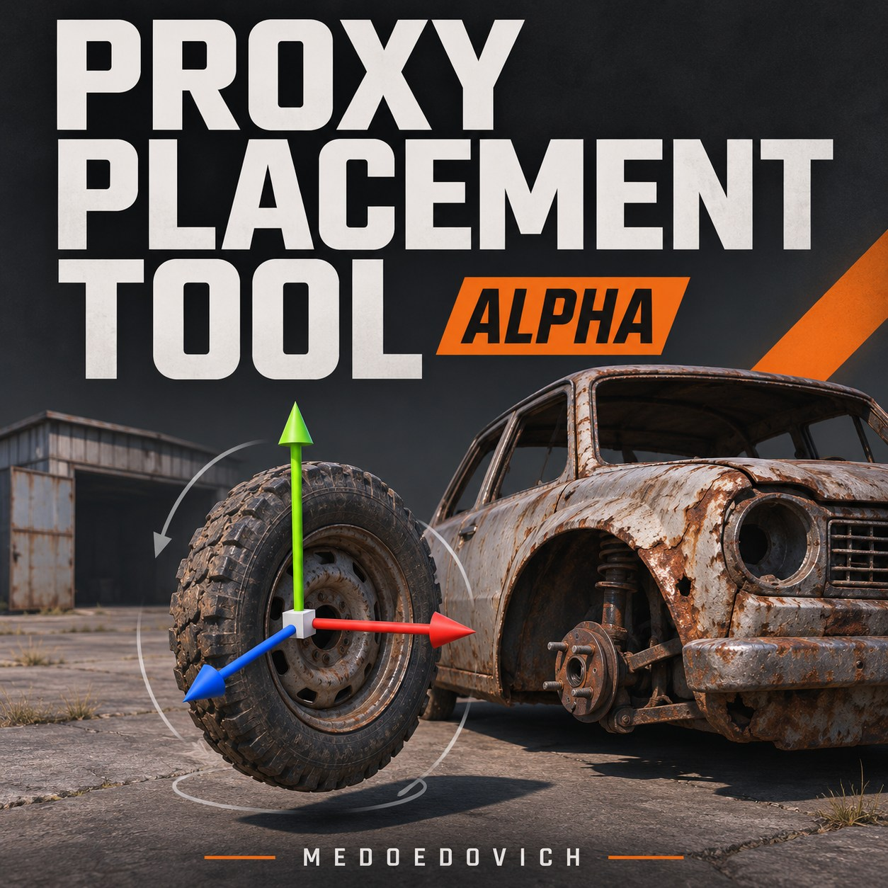

# Proxy Placement Tool — Alpha

[Steam Workshop](https://steamcommunity.com/sharedfiles/filedetails/?id=3839146464) · [English](README.md) · [Сборка](docs/BUILD.md) · [Проверки](docs/VALIDATION.md)

Автор: **Medoedovich** · **0.2.0-alpha** · **только DayZDiag, офлайн**

Инструмент для подбора позиции и углов предметов относительно зданий и остовов с экспортом CE `dispatch` XML. Выберите вещь, разместите её штатным Gizmo или задайте точные значения, проверьте действие «Взять» и раздел «Поблизости» персонажем и экспортируйте результат.

**Ранняя alpha: сохранения и открытия проектов пока нет. Перед выходом экспортируйте XML. При следующем запуске сцена начинается заново; экспортированные файлы сохраняются.**

## Запуск

Нужны Windows, DayZ, запущенный Steam, DayZ Tools и подходящий `DayZDiag_x64.exe` в каталоге игры. Обычный клиент, серверы и мультиплеер в этой alpha не поддерживаются.

1. Подпишитесь на [Proxy Placement Tool](https://steamcommunity.com/sharedfiles/filedetails/?id=3839146464) и [Test Range](https://steamcommunity.com/sharedfiles/filedetails/?id=3826868718), дождитесь загрузки обоих модов.
2. Закройте уже запущенный клиент DayZ.
3. Откройте `steamapps/workshop/content/221100/3839146464` в библиотеке Steam и запустите **Start-Editor.cmd**. Launcher автоматически найдёт DayZDiag и установленный Test Range.

В репозитории также есть проверенная сборка [`dist/@ProxyPlacementTool`](dist/@ProxyPlacementTool/). После установки Test Range запустите **Start-Editor.cmd** из этой папки. Сохраните рядом launcher, PBO и каталог `Missions`. Подключение мода в обычном DayZ Launcher само по себе редактор не открывает.

`Start-Editor.cmd -CheckOnly` проверяет пути без записи файлов и запуска игры. Также поддерживаются `-Game`, `-TestRange`, `-ExtraMods` и `-RuntimeRoot`; подробности — в [полной инструкции на русском](dist/@ProxyPlacementTool/README.ru.md).

## Работа

- В левом каталоге создайте здание или остов, затем переключитесь на «Предметы» и создайте нужную вещь. Поиск использует classnames из загруженных конфигов.
- Дерево **Объекты → карта → категория → classname** содержит подкатегории жилых зданий и остовов. «Показывать StaticObj» по умолчанию выключен. [Подробнее о распределении по картам и категориям](docs/MAP-CATALOG.md).
- Во вкладке предметов — **Предметы → категория → подкатегория → classname**. Поиск раскрывает путь без ограничения в 100 результатов, ветки обоих деревьев сохраняются при переключении вкладок. [Категории предметов](docs/ITEM-CATALOG.md), [планы](TODO.md).
- Выберите предмет в мире или в нижнем списке. **F7** — перемещение, **F8** — вращение. Справа можно точно ввести позицию и углы.
- Щелчок по пустому месту снимает выделение. **F9** возвращает выбранную вещь в положение на момент выбора.
- **F1** — курсор/полёт. WASD, Q/Z и мышь управляют камерой; колесо меняет множитель скорости от 0.1 до 16.
- **F4** — режим персонажа для проверки действия «Взять» и раздела инвентаря «Поблизости».
- «Экспорт XML опоры» сохраняет все её предметы на земле. **F10** экспортирует выбранную вещь и всю опору. **F11** включает диагностику.

Язык интерфейса выбирается по языку клиента DayZDiag: русский или английский; для остальных языков используется английский. Новые опоры и предметы создаются без перезапуска миссии.

## Экспорт и ограничения

Путь по умолчанию: `%LOCALAPPDATA%\ProxyPlacementTool\profiles\ProxyPlacement\<classname опоры>\<UTC-сеанс>_scene_<номер>.xml`.

Объедините экспортированный `dispatch` с нужной группой в `mapgroupproto.xml` целевой миссии. Сохраните стандартные контейнеры, которые ещё нужны, настройте экономику, включая `types.xml`, и проверьте результат в CE. Предпросмотр создаёт вещи скриптом; окончательный спавн лута выполняет экономика. Редактор не устанавливает XML на сервер.

Отдельные файлы экземпляров удобны при настройке, однако прототип с одним classname здания обычно применяется ко всем экземплярам этого класса. Не добавляйте дубли групп с одинаковым именем без проверки. Предметы в руках и инвентаре пропускаются при экспорте, пока не будут возвращены на землю.

Ограничения alpha: нет сохранения проектов, удаления через меню и undo/redo; опоры без поворота, масштаб 1. Преобразование проверено для CE-группы с `rpy="0 0 0" a="90"`. Работа любых модовых классов и мультиплеера не заявлена.

## Исходники и сборка

| Путь | Назначение |
| --- | --- |
| `src/iot/proxytool` | Скрипт, конфиг, stringtable, каталог карт и пять layout-файлов этой версии. |
| `package` | Переносимый launcher, информация о моде, инструкции и стартовая миссия. |
| `dist/@ProxyPlacementTool` | Проверенная готовая alpha; PBO совпадает с Workshop. |
| `tools/Build.ps1` | Изолированная сборка официальным Addon Builder с проверкой BankRev. |
| `docs` | Инструкция сборки, результаты проверок и хеш опубликованного PBO. |
| `workshop` | Копии опубликованных описаний, метаданные страницы, черновик следующего описания и иллюстрированная обложка. |

Подробности — в [инструкции сборки](docs/BUILD.md). [Правила публикации](PUBLICATION.md): тексты и размещение автор выполняет вручную. Префикс addon остаётся `iot\proxytool`; имена `IOT_` сохранены для совместимости с опубликованной сборкой. После изменения исходников нужен новый PBO. В миссии находится только стартовый код, редактор и интерфейс загружаются из PBO без file patching.

Обложка — сгенерированная иллюстрация, а не скриншот игры. Файлы игры, DayZDiag и Test Range в этот проект не включены; Test Range — [отдельный проект](../TestRange/) и зависимость в Workshop.

## Проверки и обратная связь

Версия **0.2.0-alpha** прошла по **136 проверок на русском и английском** как в отдельных локальных установках, так и в скачанной Workshop-копии. Все **167 ключей локализации** получили переводы, все **17 файлов поставки** совпали с подготовленным пакетом. Подробности — в [отчёте](docs/VALIDATION.md).

При ошибке укажите версию DayZDiag, classnames опоры и предмета, шаги воспроизведения, строки журнала RPT/script и XML. Для обращений — [GitHub Issues](https://github.com/Medoedovich/Mods/issues) и [комментарии Workshop](https://steamcommunity.com/sharedfiles/filedetails/?id=3839146464). Discord: **medoedovich**.

