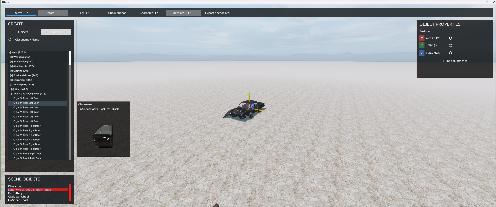
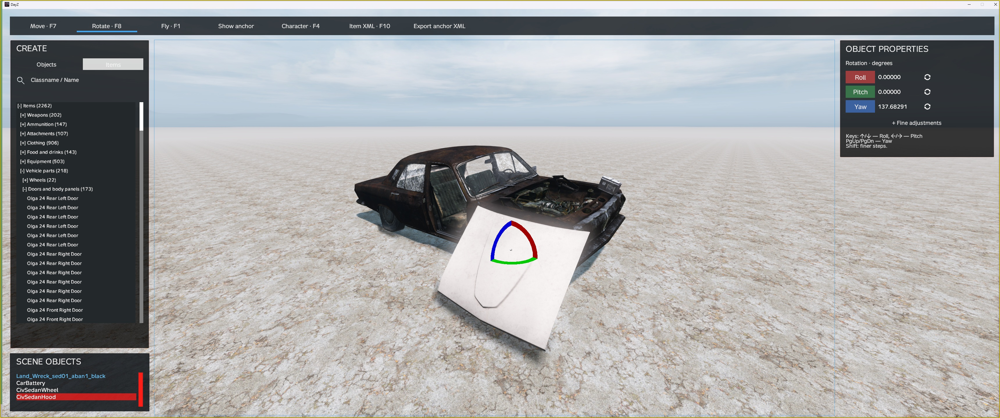
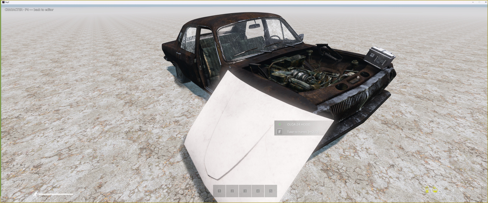

# Proxy Placement Tool — Alpha

[Steam Workshop](https://steamcommunity.com/sharedfiles/filedetails/?id=3839146464) · [Русский](README-RU.md) · [Build from source](docs/BUILD.md) · [Validation](docs/VALIDATION.md) · [Publication rules](PUBLICATION.md)

By **Medoedovich** · **0.3.0-alpha** · **DayZDiag offline only**

An offline authoring tool for placing items relative to buildings and wrecks, then exporting CE `dispatch` XML. Select an item, use the native Gizmo or enter exact coordinates and angles, inspect its take action and nearby inventory in character mode, and export the result.

**Early alpha: project save/load is not available. Export XML before exiting. Each launch starts an empty scene; exported XML files remain available.**

**0.3.0-alpha is published. All 17 files downloaded from Workshop match the validated release package.**

## Start

Requirements: Windows, DayZ, Steam running, DayZ Tools and a matching `DayZDiag_x64.exe` prepared in the game directory. The ordinary DayZ client, servers and multiplayer are unsupported in this alpha.

1. Subscribe to [Proxy Placement Tool](https://steamcommunity.com/sharedfiles/filedetails/?id=3839146464) and [Test Range](https://steamcommunity.com/sharedfiles/filedetails/?id=3826868718), and wait for both downloads.
2. Close any running DayZ client.
3. Open `steamapps/workshop/content/221100/3839146464` in the Steam library and run **Start-Editor.cmd**. The launcher automatically finds DayZDiag and the installed Test Range.

The repository also contains the tested build in [`dist/@ProxyPlacementTool`](dist/@ProxyPlacementTool/). Run its **Start-Editor.cmd** after installing Test Range. Keep the launcher, PBO and `Missions` directory together. Enabling the mod in the regular DayZ Launcher alone does not open the editor.

`Start-Editor.cmd -CheckOnly` checks installation paths without writing files or starting the game. The launcher also accepts `-Game`, `-TestRange`, `-ExtraMods` and `-RuntimeRoot`; see the [current English instructions](package/README.en.md).

## Work

- In **Objects**, open a map/category or search by classname. Drag an actual building/wreck row onto a surface inside the world frame. The editor creates and frames the anchor; a normal click only selects a catalog entry.
- The scene has **one anchor**. Dropping another opens **Replace / Cancel**; Escape cancels. Confirming removes the old anchor and its placed world items after validating the replacement. The character, inventory and existing XML exports remain. Export any layout you need before replacing it.
- **Show StaticObj** is off by default. Residential buildings and wrecks have further subcategories; both catalog trees preserve folder expansion.
- Open **Items**, search by the localized name or classname, then drag an item onto a surface in the world frame. Hover over a row for its 3D preview and full classname. Repeated drops create separate instances without a quantity limit. Drops outside the frame or over the sky cancel creation.
- Select an item by clicking its model or its row in **Scene Objects**, below the catalog. Click empty world space to deselect. **F7 / Move** shows translation arrows; **F8 / Rotate** shows rotation rings. A drag stops when it leaves the world area and requires a new press to continue.
- **Object Properties** shows Position in Move mode and Roll/Pitch/Yaw in Rotate mode. Valid numeric edits apply immediately. Each reset icon restores one component to its value at selection time; **F9** restores the full selection. Expand **Fine adjustments** for step controls.
- Select the character or anchor in Scene Objects to move that entity with the native Gizmo or world position fields. Moving the anchor leaves items in place. Item coordinates are relative to the anchor; character and anchor positions are world coordinates. Only items can rotate.
- **F1 / Fly** toggles cursor and flight. Fly with WASD, Q/Z and the mouse. The wheel changes the 0.1–16 speed multiplier, shown briefly below the center; Shift/Ctrl accelerate and Alt slows down.
- **F4 / Character** switches to the dressed test character for take-action and nearby-inventory checks. Close inventory and press F4 to return. Character HUD is hidden while editing.
- The toolbar also focuses the anchor and exports XML. **Item XML / F10** exports the selected item and the full anchor; **Anchor XML** exports all associated ground items. **F11** toggles diagnostics. Errors appear in a separate dismissible notification.

Search accepts partial queries, ignores letter case and surrounding spaces, and reveals matching branches without a 100-result cap. Objects uses classnames; Items accepts both client-localized names and classnames. Distinct classes with the same displayed name remain separate rows. Catalogs use loaded configurations, including additional mods; individual third-party classes may need separate testing.

Interface design inspired by the World Editor in Arma Reforger.

## Export and scope

Default output: `%LOCALAPPDATA%\ProxyPlacementTool\profiles\ProxyPlacement\<anchor classname>\<UTC session>_scene_<number>.xml`.

Merge the exported `dispatch` into the appropriate group in the target mission's `mapgroupproto.xml`. Preserve standard containers that you still need, configure the target economy, including `types.xml`, and test the result in CE. The editor preview creates items by script; the target economy performs the final loot spawning. An export does not deploy settings to a server.

Per-instance export files help authoring; a prototype keyed by one building classname generally affects all instances of that class. Do not blindly add duplicate groups with the same name. Items held or stored in inventory are omitted until placed on the ground.

Alpha limits: no project save/load, delete UI or undo/redo; anchors use zero orientation and scale 1. Placement was calibrated for CE groups with `rpy="0 0 0" a="90"`. No support for arbitrary mod classes or multiplayer behavior is claimed.

## Screenshots

Item placement and rotation relative to an anchor:

Checking the placed item in character mode:

[Original PNG screenshots and JPEG copies](docs/screenshots/0.3.0-alpha/README.md).

## Source and build

| Path | Purpose |
| --- | --- |
| `src/iot/proxytool` | Scripts, configuration, stringtable, map catalog and UI layouts; see CHANGELOG.md for unreleased source changes. |
| `package` | Portable launcher, mod information, instructions and bootstrap mission template. |
| `dist/@ProxyPlacementTool` | Tested ready-to-run alpha package; the PBO matches Workshop. |
| `tools/Build.ps1` | Build a new isolated package with official Addon Builder and check it with BankRev. |
| `docs` | Build instructions, validation results and published PBO hash. |
| `workshop` | Published description snapshots, item metadata, the next description draft and generated cover illustration. |

See [build instructions](docs/BUILD.md). The addon prefix remains `iot\proxytool`; the `IOT_` identifiers are retained for compatibility with the published build. Source changes must be packed into a new PBO to take effect. The packaged mission contains only the bootstrap; editor logic and UI resources are loaded from the PBO without file patching.

The cover is a generated illustration, not an in-game screenshot. DayZ game files, DayZDiag and Test Range are not bundled with this project; Test Range is a [separate project](../TestRange/) and Workshop dependency.

## Validation and reports

The **0.3.0-alpha** release package passed **292 checks per language**, resolved **207 native localization keys**, and validated **17 delivered files** in separate installed PBO copies without file patching. All 17 downloaded Workshop files match that tested package, including the PBO; a separate downloaded-copy runtime was not repeated. See [release validation](docs/VALIDATION-0.3.0.md).

Published version **0.2.0-alpha** passed **136 checks per language** in Russian and English, both in separate local installations and in the downloaded Workshop copy. All **167 localization keys** resolved, and all **17 delivered files** matched the prepared package. See [validation details](docs/VALIDATION.md).

For bugs, include the DayZDiag version, anchor/item classnames, reproduction steps, relevant RPT/script log lines and exported XML. Use [GitHub issues](https://github.com/Medoedovich/Mods/issues) or [Workshop comments](https://steamcommunity.com/sharedfiles/filedetails/?id=3839146464). Discord: **medoedovich**.

