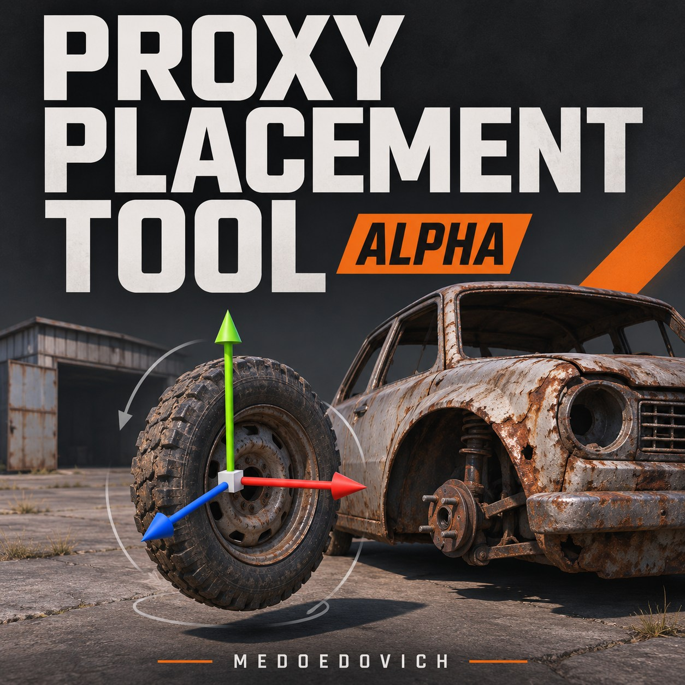

# Proxy Placement Tool — Alpha

[Steam Workshop](https://steamcommunity.com/sharedfiles/filedetails/?id=3839146464) · [Русский](README-RU.md) · [Build from source](docs/BUILD.md) · [Validation](docs/VALIDATION.md)

By **Medoedovich** · **0.1.0-alpha** · **DayZDiag offline only**

An offline authoring tool for placing items relative to buildings and wrecks, then exporting CE `dispatch` XML. Select an item, use the native Gizmo or enter exact coordinates and angles, inspect its take action and nearby inventory in character mode, and export the result.

**Early alpha: project save/load is not available. Export XML before exiting. Each launch starts an empty scene; exported XML files remain available.**

## Start

Requirements: Windows, DayZ, Steam running, DayZ Tools and a matching `DayZDiag_x64.exe` prepared in the game directory. The ordinary DayZ client, servers and multiplayer are unsupported in this alpha.

1. Subscribe to [Proxy Placement Tool](https://steamcommunity.com/sharedfiles/filedetails/?id=3839146464) and [Test Range](https://steamcommunity.com/sharedfiles/filedetails/?id=3826868718), and wait for both downloads.
2. Close any running DayZ client.
3. Open `steamapps/workshop/content/221100/3839146464` in the Steam library and run **Start-Editor.cmd**. The launcher automatically finds DayZDiag and the installed Test Range.

The repository also contains the tested build in [`dist/@ProxyPlacementTool`](dist/@ProxyPlacementTool/). Run its **Start-Editor.cmd** after installing Test Range. Keep the launcher, PBO and `Missions` directory together. Enabling the mod in the regular DayZ Launcher alone does not open the editor.

`Start-Editor.cmd -CheckOnly` checks installation paths without writing files or starting the game. The launcher also accepts `-Game`, `-TestRange`, `-ExtraMods` and `-RuntimeRoot`; see the [complete English instructions](dist/@ProxyPlacementTool/README.en.md).

## Work

- Create a building or wreck from the left catalog, then switch to **Items** and create an item. Search uses classnames from loaded configurations.
- Select an item in the world or in the bottom tray. **F7** shows translation handles; **F8** shows rotation rings. The right panel provides exact position and angle fields.
- Click empty space to deselect. **F9** resets the current item to its pose when selected.
- **F1** toggles cursor/flight. Fly with WASD, Q/Z and the mouse; the wheel changes the camera speed multiplier from 0.1 to 16.
- **F4** switches to character mode for take-action and nearby-inventory checks.
- **Export anchor XML** exports all ground items associated with the active anchor. **F10** exports the selected item and full anchor together. **F11** toggles diagnostics.

The interface follows the DayZDiag client language: Russian or English; other languages use English. Additional anchors and items can be created without restarting the mission.

## Export and scope

Default output: `%LOCALAPPDATA%\ProxyPlacementTool\profiles\ProxyPlacement\<anchor classname>\<UTC session>_scene_<number>.xml`.

Merge the exported `dispatch` into the appropriate group in the target mission's `mapgroupproto.xml`. Preserve standard containers that you still need, configure the target economy, including `types.xml`, and test the result in CE. The editor preview creates items by script; the target economy performs the final loot spawning. An export does not deploy settings to a server.

Per-instance export files help authoring; a prototype keyed by one building classname generally affects all instances of that class. Do not blindly add duplicate groups with the same name. Items held or stored in inventory are omitted until placed on the ground.

Alpha limits: no project save/load, delete UI or undo/redo; anchors use zero orientation and scale 1. Placement was calibrated for CE groups with `rpy="0 0 0" a="90"`. No support for arbitrary mod classes or multiplayer behavior is claimed.

## Source and build

| Path | Purpose |
| --- | --- |
| `src/iot/proxytool` | Exact script, configuration, stringtable and five layouts used to build the published alpha. |
| `package` | Portable launcher, mod information, instructions and bootstrap mission template. |
| `dist/@ProxyPlacementTool` | Tested ready-to-run alpha package; the PBO matches Workshop. |
| `tools/Build.ps1` | Build a new isolated package with official Addon Builder and check it with BankRev. |
| `docs` | Build instructions, validation results and published PBO hash. |
| `workshop` | Current descriptions, item metadata and generated cover illustration. |

See [build instructions](docs/BUILD.md). The addon prefix remains `iot\proxytool`; the `IOT_` identifiers are retained for compatibility with the published build. Source changes must be packed into a new PBO to take effect. The packaged mission contains only the bootstrap; editor logic and UI resources are loaded from the PBO without file patching.

The cover is a generated illustration, not an in-game screenshot. DayZ game files, DayZDiag and Test Range are not bundled with this project; Test Range is a [separate project](../TestRange/) and Workshop dependency.

## Validation and reports

Tested with DayZDiag **1.30.164289.70**. English and Russian installed copies passed 51 editor checks per language; all 64 localization keys resolved. The downloaded Workshop copy also passed 51 checks and exported separate XML files for two anchors. See [validation details](docs/VALIDATION.md) for the scope of these checks.

For bugs, include the DayZDiag version, anchor/item classnames, reproduction steps, relevant RPT/script log lines and exported XML. Use [GitHub issues](https://github.com/Medoedovich/Mods/issues) or [Workshop comments](https://steamcommunity.com/sharedfiles/filedetails/?id=3839146464). Discord: **medoedovich**.

