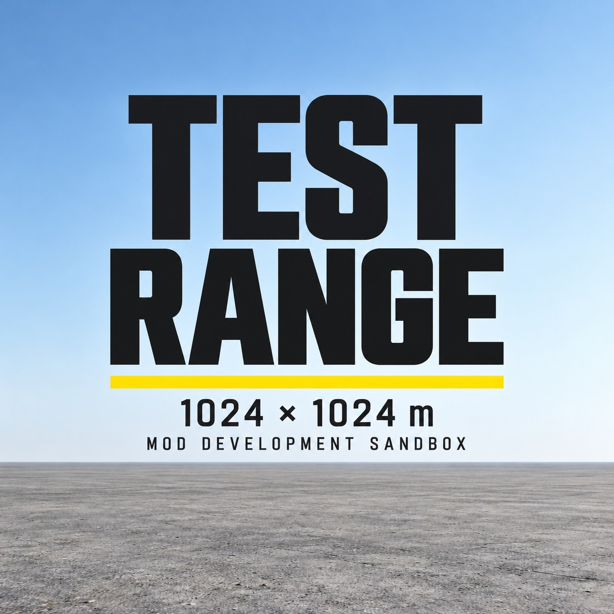

# Test Range

[Steam Workshop](https://steamcommunity.com/sharedfiles/filedetails/?id=3826868718) · [Русский](README-RU.md) · [License](LICENSE.md)



A minimal terrain for testing DayZ mods and gameplay mechanics. The repository includes the genuine Terrain Builder project, the exported WRP, generated materials, three built PBOs, mission sources and PowerShell build/launch tools.

## World

- 1024 × 1024 m world: 256 × 256 height samples at 4 m spacing.
- Uniform vanilla concrete surface; no buildings, roads, vegetation or placed objects.
- Flat interior at absolute elevation +1 m, with flat samples at X/Z=4…1016. The outer sample ring is −20 m, producing a narrow coastal transition of approximately 4 m.
- Surrounding ocean at 0 m; tide and vertical wave displacement are disabled.
- Central 250 × 250 m test area: X/Z=387…637. This is a logical area on the same surface, without markings or barriers.
- New player spawn at X/Z=512/512. The mission calculates height from the terrain.
- The included offline mission does not initialize Hive/CE. It has no automatic infected, animal, vehicle or loot population. Additional mods can change that behavior.

## Run the included build

Requirements: Windows, an installed copy of DayZ and Steam running normally. The diagnostic client must be available for the default DayZDiag workflow; `-Retail` selects the ordinary client.

Open `dist/@DayZTestRange` and double-click **Start-Offline.cmd**. The launcher discovers Steam libraries automatically and waits for `READY: offline world loaded.` No separate server or Community Offline Mode is needed.

From PowerShell opened in this project's directory:

```powershell
.\dist\@DayZTestRange\Start-Offline.cmd -CheckOnly
.\dist\@DayZTestRange\Start-Offline.cmd -Retail
.\dist\@DayZTestRange\Start-Offline.cmd -Game "D:\SteamLibrary\steamapps\common\DayZ"
.\dist\@DayZTestRange\Start-Offline.cmd -ExtraMods "D:\Mods\@Example;D:\Mods\@Another"
```

Close the previous client before starting another. Runtime profiles and storage for this standalone launcher go to `%LOCALAPPDATA%\DayZTestRange`. See [offline instructions](docs/OFFLINE.md) and [mod setup](docs/MOD-SETUP.md).

## Source and build

Install the official DayZ Tools and prepare WorkDrive with the extracted game data. The source prefix is `dtr\test_range`; the default development drive is `P:`. These internal paths and the packaged folder name remain stable even though the public title is Test Range.

The PowerShell build tools accept path parameters. Run them in a PowerShell session configured to run your local scripts:

```powershell
.\tools\Sync-WorkDrive.ps1 -WorkDrive 'P:\'
.\tools\Validate.ps1 -WorkDrive 'P:\' -RequireWorld
.\tools\Build.ps1 -WorkDrive 'P:\' -Tools 'D:\SteamLibrary\steamapps\common\DayZ Tools'
```

`Sync-WorkDrive.ps1` copies this project's source to `P:\dtr\test_range`. Preserve any newer editor changes at that location before copying. To import changes already exported from Terrain Builder, use `-Pull` first.

Open `P:\dtr\test_range\source\dayztestrange.tv4p` in Terrain Builder. Its associated V4D/V4W files, Layers, Shapes and Cache directories are included together; keep them with the project. Native terrain files are official tool outputs and must be regenerated with Terrain Builder. See [Terrain Builder settings and export steps](docs/TERRAIN-BUILDER.md).

After editor changes: save, generate layers, export WRP, run `Sync-WorkDrive.ps1 -Pull`, then `Build.ps1`. The build uses official Addon Builder, Binarize and CfgConvert; BankRev checks the resulting package. `Build.ps1 -AssetsOnly` updates data/CE only and does not produce a complete world build.

## Contents

| Path | Purpose |
| --- | --- |
| `src/dtr/test_range/source` | Heightmap, surface inputs and genuine Terrain Builder project with its companion files. |
| `src/dtr/test_range/world` | World configuration and exported WRP. |
| `src/dtr/test_range/data` | Generated terrain layers and project textures. |
| `src/dtr/test_range/ce` | Economy configuration. |
| `Missions/offline.dayztestrange` | Main offline mission. |
| `dist/@DayZTestRange` | Ready-to-run mod with standalone launcher and bundled missions. |
| `tools` | Input generation, synchronization, validation, build and launch scripts. |
| `server` | Optional development server configuration and mission. |
| `validation-source` | Observer mission used for the no-spawn audit. |
| `workshop` | Current preview, public descriptions and four actual in-game screenshots. |

## Validation and scope

The distributed build was loaded in game and downloaded/tested through Steam Workshop on DayZ 1.30.164200.56. A ten-minute audit recorded eleven samples with one player and no automatic infected, animals, vehicles or ground items. See [validation details and hashes](docs/VALIDATION.md).

Normal survival mechanics remain enabled. No admin menu, item spawner, free camera or AI navmesh is included. Some mods require a server context; offline play does not validate replication or RPC behavior. The optional server files are provided as development material; ordinary dedicated server compatibility was not validated. PBOs are intentionally unsigned for the offline workflow.

Known inherited CAWorld weather/overcast and diagnostic cleanup warnings are documented in the validation notes. A full day/night cycle and arbitrary weather changes were not separately validated.

## License and contact

Based on Bohemia Interactive's official Terrain Sample; see [LICENSE.md](LICENSE.md) for the ADPL-SA terms and attribution. Vanilla game materials are referenced by their game paths.

Discord: **medoedovich**. Use GitHub issues or Workshop comments for bug reports and general questions.
